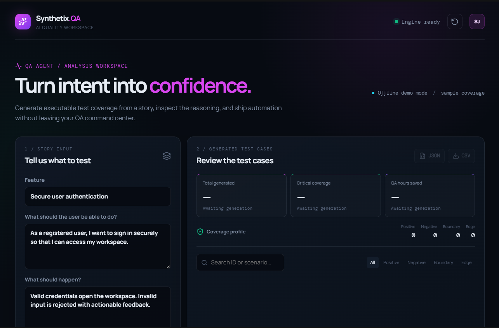
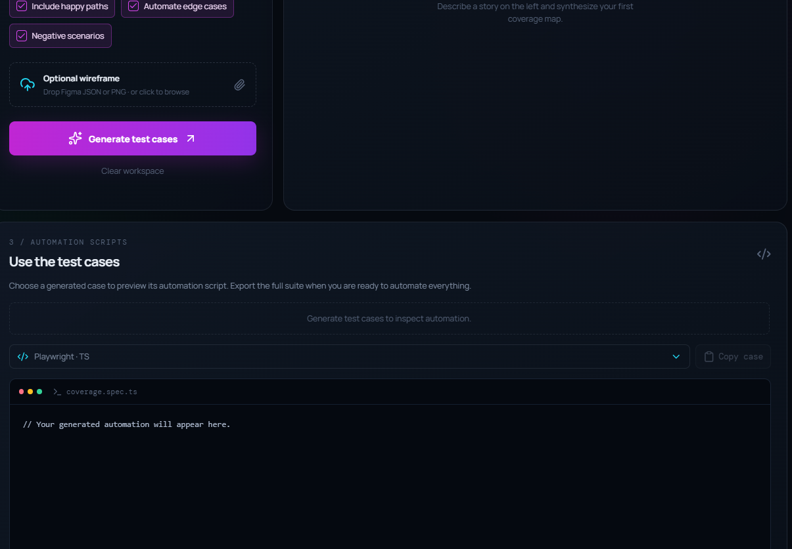

# AI Test Case Generator





> **Turn requirements into a review-ready QA suite in minutes.**
>
> Add a user story, requirement document, wireframe, or supporting JSON. The product generates structured test cases, checks their quality, and gives you exportable results and automation starters.

## Why you should use it

AI Test Case Generator helps QA, product, and engineering teams move from requirements to test coverage faster.

- Generate Positive, Negative, Boundary, and Edge test cases.
- Import TXT and PDF requirements or paste the story directly.
- Attach PNG/JPG wireframes and JSON as additional context.
- Review cases with search, filters, category counts, and expandable details.
- Export structured JSON and spreadsheet-friendly CSV.
- Preview basic Playwright, Cypress, and Gherkin automation layouts.
- Validate required fields, duplicate IDs, duplicate scenarios, category consistency, and coverage.
- Keep the OpenRouter API key on the Java server instead of exposing it in the browser.

## What the product does

1. Reads and validates the requirement.
2. Builds a structured prompt from the story and selected coverage options.
3. Generates test cases through OpenRouter.
4. Parses the response and checks its structure.
5. Validates the generated suite.
6. Shows the results in the dashboard or desktop app.
7. Exports JSON and CSV files.

### Supported inputs

| Input | Use |
|---|---|
| Pasted text | Enter Feature, User Story, and Expected Behavior in the dashboard. |
| TXT or PDF | Import a requirement document and extract recognized sections. |
| PNG or JPG | Add a wireframe or screenshot as supporting context. |
| JSON | Add structured UI or test data as supporting context. |
| Java story file | Run generation from the CLI. |

Images and JSON provide additional context. The main story comes from the editable fields or extracted TXT/PDF text.

### Generated outputs

Each case can include:

- ID, priority, category, and test type
- Scenario and preconditions
- Test data and steps
- Expected result
- Basic automation preview where available

The product provides:

- **Dashboard results** with search, filters, category totals, and case details
- **JSON** for APIs, automation, and further processing
- **CSV** for spreadsheets and test-management tools
- **Playwright TypeScript**, **Cypress JavaScript**, and **Cucumber Gherkin** previews

Default output files:

```text
output/generated_test_cases.json
output/generated_test_cases.csv
```

## Coverage and quality checks

The generator covers four test-case categories:

| Category | Focus |
|---|---|
| Positive | Valid input and expected user flows |
| Negative | Invalid input, rejected actions, and errors |
| Boundary | Minimums, maximums, limits, and empty values |
| Edge | Unusual flows, repeated actions, refreshes, and unexpected states |

The dashboard shows the count for every category. The quality validator checks that all four categories are represented.

Additional checks include:

- Required IDs, scenarios, steps, and expected results
- Valid structured AI responses
- Duplicate IDs and duplicate scenarios
- Matching category and test type
- Missing or incomplete input sections

These checks improve consistency, but they cannot prove that every AI-generated scenario matches the product perfectly. Review the suite against the requirement before using it in production.

## Automation preview

The product creates a basic Playwright layout for each selected case. It may include actions such as navigation, form filling, clicking, checking boxes, reloads, and keyboard input. It also includes the expected result and a `TODO` for steps that need application-specific locators.

The generated Playwright code is **not entirely reliable or production-ready**. Use it as a basic layout and starting point. Review and adapt the locators, test data, authentication, environment setup, and assertions before running it against a real application.

## Project structure

```text
src/main/java/       Java application, API, services, and validators
src/test/java/       JUnit tests
src/main/resources/  Non-secret configuration
frontend/            React dashboard
input/               Example story files
output/              Generated JSON and CSV files
```

## Important files

| File | Purpose |
|---|---|
| `Main.java` | Runs the command-line generator. |
| `GuiMain.java` | Opens the Swing desktop application. |
| `Launcher.java` | Starts GUI, CLI, or API-server mode. |
| `GenerationService.java` | Coordinates generation, parsing, validation, and export. |
| `ApiServer.java` | Provides the API used by the React dashboard. |
| `TestCaseValidator.java` | Checks fields, duplicates, and category consistency. |
| `TestCaseQualityValidator.java` | Checks coverage of all four categories. |
| `frontend/src/App.tsx` | Main dashboard workflow and results view. |
| `frontend/src/automation/scripts.ts` | Creates automation previews. |

## Setup

### Requirements

- Java 25 LTS
- Maven
- Node.js and npm
- An OpenRouter API key for real AI generation

### Configure the API key

In PowerShell, set the key in the terminal that starts the Java server:

```powershell
$env:OPENROUTER_API_KEY="your-openrouter-api-key"
```

The key stays on the Java server. Do not put it in a `VITE_*` variable or commit it to Git.

## Use the product

### Option 1: React dashboard with real AI

Use two terminals so the Java server can protect the API key while React serves the interface.

**Terminal 1: start the Java API**

```powershell
$env:OPENROUTER_API_KEY="your-openrouter-api-key"
mvn exec:java "-Dexec.mainClass=com.sakshi.Launcher" "-Dexec.args=--server"
```

The API runs at `http://localhost:8080`. Confirm it is ready at:

```text
http://localhost:8080/api/health
```

Expected response:

```json
{"status":"ok"}
```

**Terminal 2: start the dashboard**

```powershell
npm --prefix frontend install
$env:VITE_API_BASE_URL="http://localhost:8080"
npm --prefix frontend run dev
```

Open the Vite URL, usually:

```text
http://localhost:5173
```

Paste or import a story, attach optional context, choose coverage options, and select **Generate test cases**.

### Option 2: Demo mode

Start the dashboard without `VITE_API_BASE_URL`:

```powershell
npm --prefix frontend run dev
```

Demo mode shows sample fixture data without Java or an API key. It is useful for exploring the interface but does not call the AI service.

### Option 3: Java CLI

Generate from a file:

```powershell
mvn exec:java "-Dexec.mainClass=com.sakshi.Main" "-Dexec.args=input/user_story.txt"
```

Run without a file argument to be prompted for a path:

```powershell
mvn exec:java "-Dexec.mainClass=com.sakshi.Main"
```

### Option 4: Java desktop app

```powershell
mvn exec:java "-Dexec.mainClass=com.sakshi.GuiMain"
```

The desktop app supports file browsing, story previews, generation, JSON viewing, CSV-style results, and output locations.

### Option 5: VS Code

1. Open the repository root.
2. Install the Extension Pack for Java.
3. Set `OPENROUTER_API_KEY` in the integrated terminal.
4. Open **Run and Debug** with `Ctrl+Shift+D`.
5. Select a profile and press `F5`.

Available profiles are Launcher, CLI, and GUI. They use the project classpath and Maven dependencies.

## API

```text
GET  http://localhost:8080/api/health
POST http://localhost:8080/api/generate
```

Example request:

```json
{
  "feature": "User Login",
  "userStory": "As a registered user, I want to log in.",
  "expectedBehavior": "Valid users reach the dashboard."
}
```

## Build and test

```powershell
mvn clean test
npm --prefix frontend run build
```

The Java tests cover response parsing, AI-service errors, file handling, CSV export, input validation, duplicate detection, category validation, and quality validation.

## Technology

Java 25, Maven, OpenRouter, OkHttp, Jackson, SLF4J, Swing, React, Vite, TypeScript, and JUnit 5.

## Security and responsible use

- Keep the OpenRouter key in `OPENROUTER_API_KEY`.
- Never commit the key to Git.
- Never put the key in frontend code or `VITE_*` variables.
- Review generated cases and automation previews before production use.

## Author

Sakshi Jamanani
